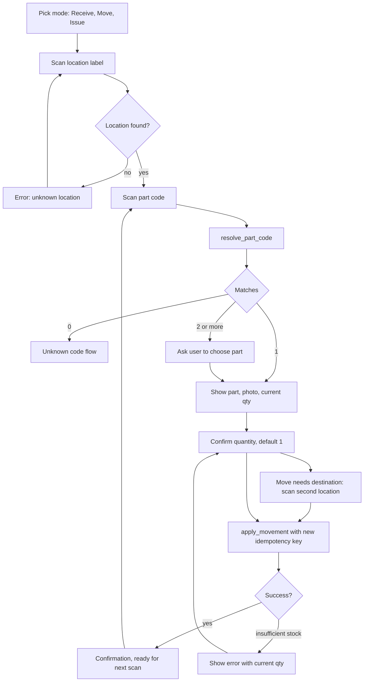
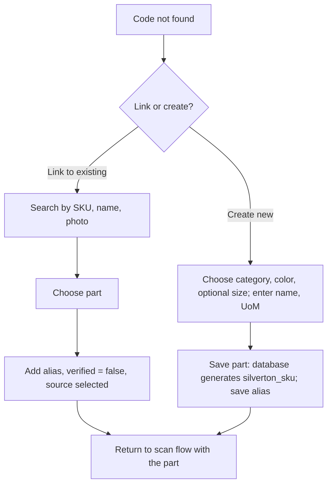
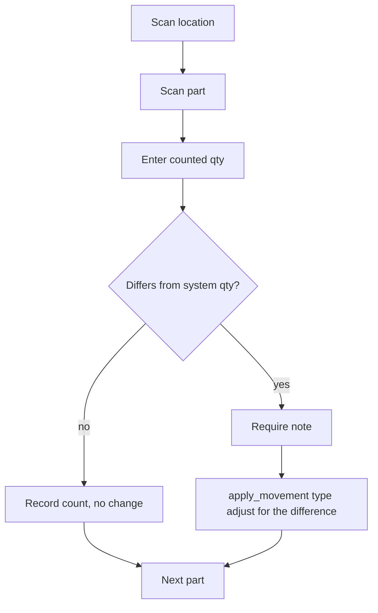
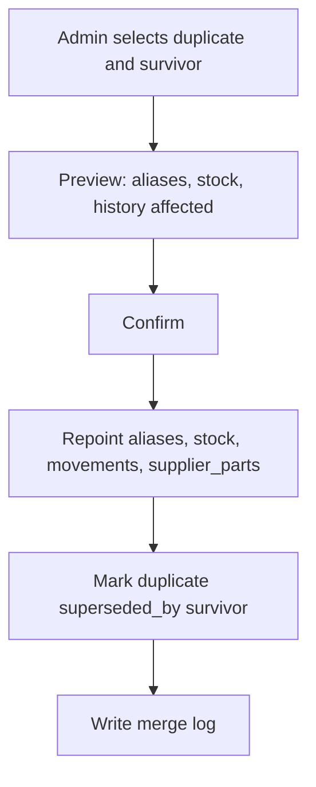
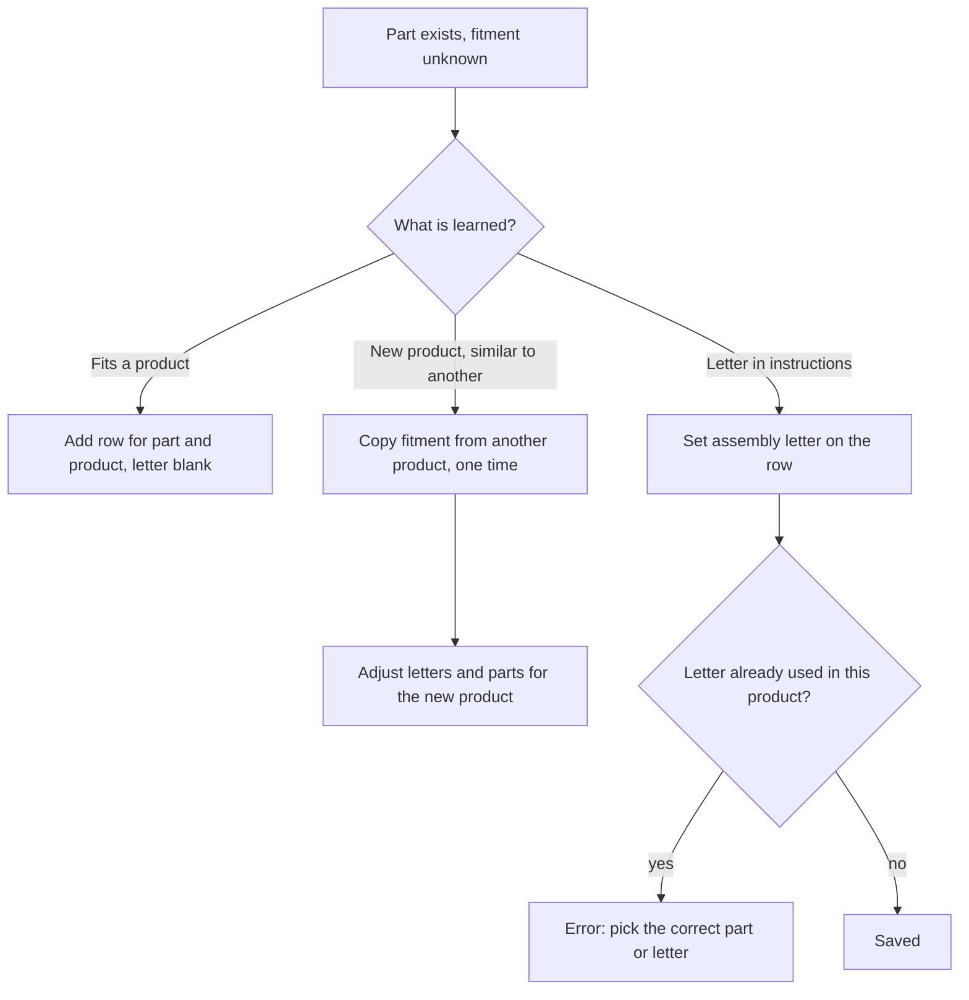

# Process flows

## 1. Scan flow (Receive / Move / Issue)

Notes: scanning matches a silverton_sku or any alias, with or without dashes. In Receive the scanned location is the destination; in Issue it is the source; in Move it is the source and a second scan sets the destination.

## 2. Unknown code

Unverified aliases are flagged for an admin to confirm.

## 3. Cycle count (Count mode)

## 4. Part merge (SHOULD, later slice)

Alias conflicts (same normalized number and source on both parts) must be resolved before the merge proceeds.

## 5. Capturing fitment later (SHOULD)
Fitment is often learned after a part is already in stock. It never blocks receiving or scanning.

Each product is independent: copying never links the two products.
